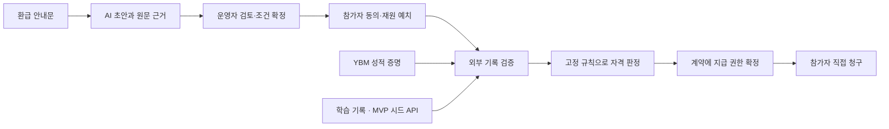

# CLEAR

2026-10-23 현황: [시험 클라이언트 준비·실제 원천 요청 전 실패·수정 후 미재시험](docs/status.md#2026-10-23-공개-현황)을 구분했습니다. HackerRank #103은 API 작업 브랜치에만 병합됐으며 develop/main 기능 반영이나 전체 시연 완료가 아닙니다.

2026-10-21 현황: [미병합 TEST 연결·실제 합성 AI 평가와 남은 원천 차단](docs/status.md#2026-10-21-공개-현황)을 갱신했습니다. 격리 체인의 합성 원천 지급과 공개 합성 8건 평가(7 PASS·1 보완)는 실제 원천 전체 시연·제품 지급 완료와 구분합니다. 기존 코드와 사용법은 유지합니다.

**2026-10-19 공개 현황:** 새 E1~E6 TEST 준비·비지급 계약·Mac 시험 보강은 열린 PR의 작업으로 main/develop 미병합입니다. [제공 범위·준비 상태·CI 실패 구분](docs/status.md#2026-10-19-공개-현황)을 확인하세요. main의 기존 코드와 사용법은 그대로입니다.

**2026-10-18 공개 현황:** 새 Python 부트캠프 계획·HackerRank 오프라인 증거·합성 ledger·지급 권한/재원 리뷰는 열린 PR의 작업이며 main/develop 미병합입니다. [현재 제공 범위와 미병합 작업](docs/status.md#2026-10-18-공개-현황)을 구분해 확인하세요. main의 코드·기존 설치/실행 방법은 그대로입니다.

**2026-10-17 공개 현황:** develop에 합성 C1~C3 신청·문서·증거 평가 흐름과 격리 Moodle·AI 후속이 병합됐습니다. 해당 기능 코드는 main에 미반영이며, main의 기존 설치/실행 방법은 유지합니다. [브랜치별 제공 범위와 미검증 항목](docs/status.md#2026-10-17-공개-현황)을 확인하세요.

**공개 현황 — 2026-10-15:** 기본 브랜치 `main`에서 재현할 수 있는 경로는 아래 기존 ProofAdapter 합성 테스트입니다. 제품 코드·의존성·실행 명령은 유지하고, [문서 검증 CI 구성 PR #49](https://github.com/gw020328-oss/clear-education-v4/pull/49)만 추가했습니다. `develop`에는 별도 등록 이력 접수·실제 수집기 연결과 격리 TEST 재원 실험이 병합돼 있지만 **main에는 해당 기능 코드가 미반영**입니다. [브랜치별 제공 범위·공개 근거](docs/status.md#2026-10-15-공개-현황)를 확인하세요.

**교육 환급 프로그램을 위한 조건 구조화 · 외부 기록 검증 · 조건부 지급 모듈**

[시작하기](#시작하기) · [아키텍처](docs/architecture.md) · [개발 현황](docs/status.md) · [문서](docs/README.md) · [기여 안내](CONTRIBUTING.md)

CLEAR는 어학원 환급 안내를 검토 가능한 규칙으로 정리하고, 시험 성적과 학습 기록을 확인해 사전 예치된 재원의 지급으로 연결하는 프로젝트입니다. 운영자의 반복적인 증빙 확인 부담을 줄이고, 참가자가 확정된 조건과 지급 권리를 확인하도록 하는 것이 목표입니다.

> **개발 중인 해커톤 프로젝트입니다.** 현재 이 저장소에서 재현할 수 있는 경로는 합성 자료를 이용한 검증 모듈 테스트입니다. 실제 YBM 증명부터 지급까지 연결된 v4 서비스와 공개 데모는 아직 제공하지 않습니다.

## 주요 기능

| 기능 | 설명 | 현재 단계 |
| --- | --- | --- |
| AI 조건 구조화 | 안내문에서 조건·원문 근거를 추출하고 누락·충돌 검토를 보조 | 기존 시제품 구현, TOEIC 규칙으로 확장 예정 |
| 외부 성적 증명 | Reclaim을 통해 확보한 YBM 응답의 출처·서명·시험 연결 검사 | 별도 실제 실험 성공, v4 통합 중 |
| 학습 조건 확인 | 필수 강의의 완료 기록으로 수강률 집계 | 시드 API와 판정기 구현 예정 |
| 조건부 지급 | 동의한 규칙·수취인·기한을 고정하고 예치금 중복 지급 차단 | 기존 로컬 시제품 구현, v4 통합 예정 |
| 직접 청구 | 지급 권한 확정 후 참가자가 서비스의 추가 승인 없이 청구 | 기존 로컬 시제품 구현, v4 적용 예정 |

## 동작 흐름

아래는 **목표 아키텍처**입니다. 전체 통합 완료를 뜻하지 않습니다.



AI는 조건 설정을 돕고, 지급 자격은 고정된 규칙으로 판단합니다. v4에서는 증명을 체인 밖에서 검증하고 최소 지급 권한만 체인에 등록합니다. 블록체인의 역할은 **권한 확정 후 추가 승인 없이 기한 내 청구하게 하는 것**이며, 발급 전 검증 서버에 대한 신뢰는 남습니다. [신뢰 경계와 설계 상세](docs/architecture.md)

## 시작하기

### 요구 사항

- Git
- Node.js **24.21.0**, npm **11.19.0**
- macOS 또는 Linux의 POSIX 셸; Windows에서는 WSL 사용

프로젝트의 실행 도구가 고정 버전을 확인합니다. 다른 버전이면 실행을 중단합니다.

### 합성 검증 테스트 실행

```sh
git clone https://github.com/gw020328-oss/clear-education-v4.git
cd clear-education-v4

./tools/node --version
./tools/npm --version
./tools/npm --prefix spikes/w02-proof-adapter ci --ignore-scripts
./tools/npm --prefix spikes/w02-proof-adapter test
```

의존성 설치에는 네트워크가 필요합니다. 테스트에는 **YBM 계정, API 키, 지갑 자금이 필요하지 않습니다.** 시험용 키와 자료를 메모리에서 생성하며, 테스트 중 `fetch` 호출을 차단합니다.

기준 결과는 **36개 통과**입니다. 신청·지갑·출처·서명·시험 연결·재사용을 검사하며, 실제 YBM 증명 생성·TEE·800점/80% 자격 판정·지급·DB 동시성은 검증하지 않습니다. [테스트 범위](spikes/w02-proof-adapter/README.ko.md)

전체 개발 환경 준비와 문제 해결은 [개발 가이드](docs/development.md)를 참고하세요.

## 기술 구성

| 영역 | 기술 |
| --- | --- |
| 런타임·테스트 | Node.js 24.21.0, 내장 `node:test` |
| 증명 검증 실험 | Reclaim JS SDK 5.8.2, ethers 6.17.0 |
| 기존 계약·로컬 체인 | Solidity, solc 0.8.30, Ganache 7.9.2 |
| 기존 시제품 화면·서버 | HTML/CSS/JavaScript, Node.js |
| AI 조건 초안 | 기존 Gemini 연동 코드 및 캐시·수동 입력 경로 |

## 저장소 구조

```text
.
├── config/                 # 환경 분리 설정과 미배포 manifest
├── docs/                   # 제품 요구사항, 설계, 검증 기록
│   ├── reference/          # PRD·기술 설계·구현 계획
│   ├── w01/                # 개발 환경 준비 기록
│   └── w02/                # 증명 검증 실험과 경로 설계
├── spikes/
│   └── w02-proof-adapter/  # 실행 가능한 합성 검증 테스트
├── legacy/                 # 기존 단계별 시제품의 소스 참고본
├── tools/                  # 고정 런타임과 환경 검증 도구
└── CONTRIBUTING.md         # 작업·검증·PR 안내
```

`legacy/`는 변경하지 않는 참고본이며 과거 데이터·fixture 전체를 포함하지 않습니다. 통합 앱처럼 실행할 수 있는 완전한 복제본은 아닙니다.

## 로드맵

- [x] 기존 시제품과 실제 YBM 실험의 근거 점검
- [x] v4 요구사항·기술 설계와 개발 환경 준비
- [x] 증명 검증 모듈의 오프라인 합성 시험
- [ ] 기존 YBM 생성 경로의 TEE·지갑·문맥 호환성 확인
- [ ] 새 실제 성적 증명 + 시드 학습 기록 + 로컬 지급 연결
- [ ] 삭제·장애·중복·직접 청구 검증
- [ ] 비개발자 2명의 사용성 시험

MVP 조건은 **TOEIC 총점 800점 이상 AND 필수 강의 수강률 80% 이상**입니다. 실명 본인확인, 실제 학원 API, 원화 지급, 공개 Amoy 지급은 후속 범위입니다. [상세 현황](docs/status.md) · [PRD](docs/reference/PRD.ko.md)

## 참여 및 문의

5팀 환급킬러가 개발합니다. 일반적인 질문이나 오류는 [Issues](https://github.com/gw020328-oss/clear-education-v4/issues)에 재현 방법과 함께 남겨주세요. 실제 성적·신원 정보·쿠키·개인키는 첨부하지 마세요. 코드 변경은 [기여 안내](CONTRIBUTING.md)를 따릅니다.

## 라이선스

별도 오픈소스 라이선스는 아직 지정하지 않았습니다. 의존성에는 각 프로젝트의 라이선스가 적용됩니다.
