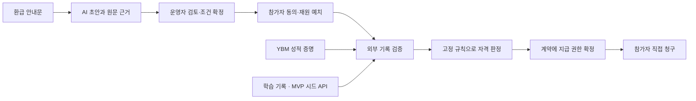

# CLEAR

**교육 환급 프로그램을 위한 조건 구조화 · 외부 기록 검증 · 조건부 지급 모듈**

[시작하기](#시작하기) · [아키텍처](docs/architecture.md) · [개발 현황](docs/status.md) · [문서](docs/README.md) · [기여 안내](CONTRIBUTING.md)

CLEAR는 어학원 환급 안내를 검토 가능한 규칙으로 정리하고, 시험 성적과 학습 기록을 확인해 사전 예치된 재원의 지급으로 연결하는 프로젝트입니다. 운영자의 반복적인 증빙 확인 부담을 줄이고, 참가자가 확정된 조건과 지급 권리를 확인하도록 하는 것이 목표입니다.

> **개발 중인 해커톤 프로젝트입니다.** `develop`에는 본인 실제 YBM 접수·성적 증명 1쌍의 새 생성과 독립 검증 성공 기록이 있습니다. 제품 자격 판정·지급까지 연결된 v4 서비스와 공개 데모는 아직 제공하지 않습니다. 계정 없이 재현하는 기본 검증은 합성 테스트입니다.

2026-10-12 14:11 KST 공개 근거 확인: PR #1~#4·#6~#8은 `develop` (`841052a`)에 병합됐으며 `main` (`375051e`)에는 아직 반영되지 않았습니다. 아래 최신 구현·Mac 진행 내용은 `develop` 기준입니다. [커밋·PR·CI와 검증 범위](docs/status.md)를 확인하세요.

## 최신 Mac 작업본

현재 Mac의 관리형 임시 저장과 종료·재시작 정리 정책을 승인된 MVP 기준으로 적용했습니다. [변경된 PRD·설계와 일정](docs/current/MAC_MVP.ko.md), [저장 경계 시험 결과](docs/w02/MAC_STORAGE_REPORT.ko.md), [합성 ZIP 사용 안내](docs/current/MAC_TOOL_GUIDE.ko.md)를 참고하세요. 기존 ZIP과 기본 실행은 합성 저장 경계 시험용입니다.

별도 진단 모드에서는 공식 Attestor의 동일 client로 새 증명을 생성하고, 별도 프로세스에서 공증자 서명·신청/수취 지갑 결합·원천 정책·신선도·같은 시험 연결을 검증했습니다. [공개 보고서](docs/w02/YBM_PROOF_REPORT.ko.md)와 [검증 기록](docs/w02/ybm-proof-verification.json)의 실제 성공 실행은 `1a99de4`이며, 이번 문서 확인에서 재실행한 결과가 아닙니다. 이 실제 증명 기록은 메모리의 로컬 진단 신청·테스트 지갑 범위입니다. 이후 develop에는 [합성 정책·최고점/800점 AND 시드 80% 평가](docs/current/POLICY_EVALUATOR.ko.md), [지갑 인증·SQLite 영속 신청/동의](docs/current/WALLET_APPLICATIONS.ko.md), [금고 설정·최종 동의·예치 확인](docs/current/VAULT_ENROLLMENT.ko.md)이 추가됐습니다. 금고 권한·청구·회수는 메모리 EVM과 무가치 TEST 토큰의 합성 계약 시험까지이며, 제품 proof 세션·영속 proof nonce·시험 중복·발급 outbox·독립 청구와 실제 자격/지급 통합은 미완료입니다. 타 사용자 자기 PC/계정의 실제 수집과 비개발자 2명의 합성 사용성 시험도 남아 있습니다.

```sh
./tools/node --test tests/mac-collector/*.test.mjs
./tools/node src/mac-collector/launch.mjs
./tools/node tools/package-mac-collector.mjs
```

Mac 실행은 Apple Silicon·설치된 Chrome·활성화된 FileVault가 필요하며, 새 앱 임시 폴더만 Time Machine에서 제외합니다. 원본 코드·실험 자료·개인 Chrome 프로필은 보존합니다.

## 주요 기능

| 기능 | 설명 | 현재 단계 |
| --- | --- | --- |
| AI 조건 구조화 | 안내문에서 조건·원문 근거를 추출하고 누락·충돌 검토를 보조 | 기존 시제품 구현, TOEIC 규칙으로 확장 예정 |
| 외부 성적 증명 | Reclaim을 통해 확보한 YBM 응답의 출처·서명·시험 연결 검사 | develop의 v4 로컬 진단에서 본인 새 증명 1쌍 생성·독립 검증 성공, 제품 통합은 후속 |
| 학습 조건 확인 | 고정 필수 강의와 시드 snapshot으로 정수 완료율 평가 | 합성 정책·결정적 80% 평가 구현, 실제 시드 API·proof 연결은 후속 |
| 조건부 지급 | 금고 설정·최종 동의·예치와 고정 수취인 권리 | v4 금고·등록/예치 및 지급·회수 계약 합성 검증, 제품 발급/실제 지급은 후속 |
| 직접 청구 | 고정 수취인이 권한으로 청구 | v4 계약 단위 합성 검증, 독립 청구 패킷·클라이언트 연결은 후속 |

## 동작 흐름

아래는 **목표 아키텍처**입니다. 전체 통합 완료를 뜻하지 않습니다.



AI는 조건 설정을 돕고, 지급 자격은 고정된 규칙으로 판단합니다. v4에서는 증명을 체인 밖에서 검증하고 최소 지급 권한만 체인에 등록합니다. 블록체인의 역할은 **권한 확정 후 추가 승인 없이 기한 내 청구하게 하는 것**이며, 발급 전 검증 서버에 대한 신뢰는 남습니다. [신뢰 경계와 설계 상세](docs/architecture.md)

## 시작하기

### 요구 사항

- Git
- Node.js **24.21.0**, npm **11.19.0**
- macOS 또는 Linux의 POSIX 셸; Windows에서는 WSL 사용

프로젝트의 실행 도구가 고정 버전을 확인합니다. 다른 버전이면 실행을 중단합니다.

### 합성 검증 테스트 실행

```sh
git clone --branch develop https://github.com/gw020328-oss/clear-education-v4.git
cd clear-education-v4

./tools/node --version
./tools/npm --version
./tools/npm --prefix spikes/w02-proof-adapter ci --ignore-scripts
./tools/npm --prefix spikes/w02-proof-adapter test
```

의존성 설치에는 네트워크가 필요합니다. 테스트에는 **YBM 계정, API 키, 지갑 자금이 필요하지 않습니다.** 시험용 키와 자료를 메모리에서 생성하며, 테스트 중 `fetch` 호출을 차단합니다.

이 ProofAdapter 모듈의 저장된 기준 결과는 **107개 통과**입니다. 전체 수집기·저장 경계 시험 수와 구분합니다. 신청·지갑·출처·서명·시험 연결·재사용을 검사하며, 실제 YBM 증명 생성·TEE·800점/80% 자격 판정·지급·DB 동시성은 검증하지 않습니다. [테스트 범위](spikes/w02-proof-adapter/README.ko.md)

전체 개발 환경 준비와 문제 해결은 [개발 가이드](docs/development.md)를 참고하세요.

## 기술 구성

| 영역 | 기술 |
| --- | --- |
| 런타임·테스트 | Node.js 24.21.0, 내장 `node:test` |
| 합성 ProofAdapter 실험 | Reclaim JS SDK 5.8.2, ethers 6.17.0 |
| YBM 진단 수집기 | Reclaim Attestor Core 5.1.4, 동일 client 생성·별도 프로세스 검증 |
| 기존 계약·로컬 체인 | Solidity, solc 0.8.30, Ganache 7.9.2 |
| 기존 시제품 화면·서버 | HTML/CSS/JavaScript, Node.js |
| AI 조건 초안 | 기존 Gemini 연동 코드 및 캐시·수동 입력 경로 |

## 저장소 구조

```text
.
├── config/                 # 환경 분리 설정과 미배포 manifest
├── docs/                   # 제품 요구사항, 설계, 검증 기록
│   ├── current/            # 승인된 Mac MVP 범위와 합성 ZIP 안내
│   ├── reference/          # PRD·기술 설계·구현 계획
│   ├── w01/                # 개발 환경 준비 기록
│   └── w02/                # 증명 검증 실험과 경로 설계
├── src/                    # Mac/YBM 진단·합성 정책/평가·영속 신청·금고 연결
├── contracts/              # v4 금고·무가치 시험 토큰 (합성 검증)
├── spikes/
│   └── w02-proof-adapter/  # 실행 가능한 합성 검증 테스트
├── legacy/                 # 기존 단계별 시제품의 소스 참고본
├── tools/                  # 고정 런타임과 환경 검증 도구
└── CONTRIBUTING.md         # 작업·검증·PR 안내
```

`legacy/`는 변경하지 않는 참고본이며 과거 데이터·fixture 전체를 포함하지 않습니다. 통합 앱처럼 실행할 수 있는 완전한 복제본은 아닙니다.

## 로드맵

- [x] 기존 시제품과 실제 YBM 실험의 근거 점검
- [x] v4 요구사항·기술 설계와 개발 환경 준비
- [x] 증명 검증 모듈의 오프라인 합성 시험
- [x] develop: Mac 관리형 저장·복구 및 본인 새 YBM 증명 1쌍 생성·독립 검증
- [x] develop: 합성 정책·결정적 자격 평가와 지갑 인증·영속 신청/동의
- [x] develop: 메모리 EVM의 금고 설정·최종 동의·예치 확인 및 복구
- [ ] 제품 proof 세션·영속 proof nonce·시험 중복·발급 outbox 연결
- [ ] 새 실제 성적 증명 + 시드 학습 기록 + 로컬 지급 연결
- [ ] 삭제·장애·중복·직접 청구 검증
- [ ] 타 사용자 자기 PC·계정 실제 수집 최소 1건
- [ ] 별도 비개발자 2명의 합성 사용성 시험

MVP 조건은 **TOEIC 총점 800점 이상 AND 필수 강의 수강률 80% 이상**입니다. 실명 본인확인, 실제 학원 API, 원화 지급, 공개 Amoy 지급은 후속 범위입니다. 추가 TEE는 승인된 후속 보장이며 기존 TEE 시험 통과를 뜻하지 않습니다. [상세 현황](docs/status.md) · [최신 Mac MVP 범위](docs/current/MAC_MVP.ko.md) · [원래 PRD](docs/reference/PRD.ko.md)

## 참여 및 문의

5팀 환급킬러가 개발합니다. 일반적인 질문이나 오류는 [Issues](https://github.com/gw020328-oss/clear-education-v4/issues)에 재현 방법과 함께 남겨주세요. 실제 성적·신원 정보·쿠키·개인키는 첨부하지 마세요. 코드 변경은 [기여 안내](CONTRIBUTING.md)를 따릅니다.

## 라이선스

별도 오픈소스 라이선스는 아직 지정하지 않았습니다. 의존성에는 각 프로젝트의 라이선스가 적용됩니다.
