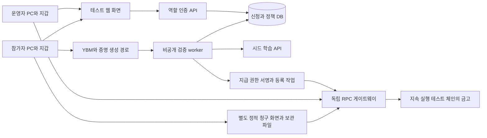
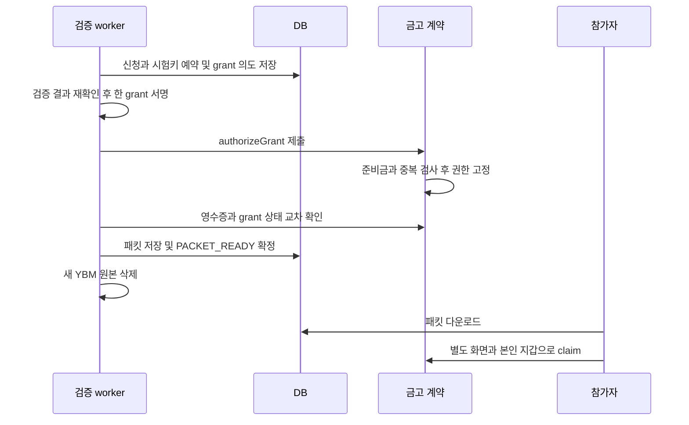

# CLEAR 3단계 기술 설계

2026년 10월 10일 · 설계 초안 v1.0 · 기준 PRD v0.3 · 목표 시연 2026년 11월 7일

CLEAR는 **비공개 증명 검증 서비스가 자격을 판단하고, 예치된 금고 계약에 지급 권한을 확정한 뒤 참가자가 직접 청구하는 구조**로 구현한다. 점수·학습 개인정보를 체인에 올리지 않고, 발급 이후의 지급은 운영자 API와 분리한다. 11월 7일에는 처음 쓰는 체험자 최소 2명이 각자 PC에서 운영자·참가자 과업을 개발자 도움 없이 완료해야 한다.

최소 MVP는 실제 YBM 성적 보유자 1명의 새 증명 연결·로컬 지급과 별도 합성 신청 최소 2개의 격리 검증이다. 외부 PC용 테스트 사이트는 이 기능을 영속 저장·역할 인증·외부 지갑·독립 청구 화면으로 확장한다. 공개 Amoy 지급과 실제 LMS는 후속이다.

설계와 구현 일정만 작성했다. 제품 코드·PRD·기존 실험을 수정하거나 로그인·증명 생성·체인 거래·배포·체험자 연락을 실행하지 않았다. 기술 선택은 아래 권고 설계이며 구현 완료를 뜻하지 않는다.

## 기준과 결정 상태

- PRD v0.3 (비공개 로컬 자료)의 D01–D15와 A01–A18, U01–U06을 구현 기준으로 사용한다.
- [1단계 점검 보고서](AUDIT.ko.md)의 기존 코드·과거 시험·미연결 경계를 유지한다. 그 보고서의 당시 미정 수치는 현재 PRD가 우선한다.
- [단계별 구현 계획](IMPLEMENTATION_PLAN.ko.md)에 11월 7일까지의 작업 순서, 의존성, 통과 기준과 지연 대응을 정리했다.

| 구분 | 설계에 적용할 내용 |
| --- | --- |
| 사용자 확정 | 800점 이상 AND 필수 강의 완료율 80% 이상, 인정 기간 내 검증된 최고 총점, 동의 전 강의 목록 고정 |
| 사용자 확정 | 예치 후 지갑 고정, 같은 반의 동일 시험 기록 중복 지급 차단, 발급 후 취소·추가 승인 불가 |
| 사용자 확정 | 제출 마감 T 이후 장애 보완 3일, 최종 청구 T+10일, 장애 대상 반의 등록 참가자 전체 적용, 이후 미정산 회수 |
| 사용자 확정 | 새 원본은 발급 완료 후 삭제, 미발급 원본은 수집 후 최대 24시간, 서비스 잔여 사본은 최종 청구 마감 후 30일 이내 삭제 |
| 권고 기본값 유지 | TOEIC L&R, 50 TEST 1회, 운영자 전액 예치, 참가자 보증금·수수료 없음. 사용자 확정으로 재분류하지 않음 |
| 실행 전 미확정 | 기존 실제 시험일을 포함하는 가상 운영기간, 신청·정상 제출의 실제 날짜. 정책 게시 전에 확정 필요 |
| 기술 설계 선택 | 반별 금고, 비공개 검증, 계약에서 지급 권한 사전 확정, 외부 지갑 직접 청구, 영속 DB, 별도 복구 배포 |

## 기존 자산과 새 구현의 경계

기존 Stage14 서버는 전역 상태 한 개와 서버가 가진 임시 역할 키를 사용한다. 그대로 외부에 공개하지 않는다. Stage15의 실제 설정 해시·동의 결합·정확한 예치·정산 불변식은 재사용하되, 네 개의 고정 receipt를 교육 자격으로 바꾸는 얇은 어댑터만으로 해결하지 않는다.

| 자산 | 재사용 | 바꿀 부분 |
| --- | --- | --- |
| stage14 정책 검토 | 원문 근거, DRAFT, 사람의 확정, 수동 경로 | 고정 문구를 교육 정책 schema로 교체. 캐시는 입력·schema 일치 시만 사용 |
| stage15 runtime과 계약 | 실제 필드에서 설정 해시 계산, 도메인 분리, 일회 정산·회수 경계 | 새 버전 4 schema, 신청 단위 저장, 반 단위 시험 중복 차단, 지급 권한 확정 |
| stage14 recovery | 배포·설정·준비금 검증 후 직접 청구 | 서버 config에 담긴 임시 지갑과 잠금 해제 RPC 제거, 사용자 파일·외부 지갑·독립 배포 기준 사용 |
| YBM verify-linked | 허용 원천·정책·서명·시험 연결·시간 검증의 순서 | 개인별 expected 값 고정 비교 제거, 신청 challenge 결합, 점수 규칙·중복 식별 |
| YBM prove-linked | 두 원천을 연결한 실험 경험 | 개발자 캡처·쿠키 주입·진단 키 생성 대신 사용자가 수행할 수 있는 증명 생성 흐름 |
| 과거 시험 결과 | 실패 유형과 회귀 검증 입력 참고 | 새 코드가 통과했다고 간주하지 않고 새 보고서를 생성 |

직접 확인한 기존 의존성은 ethers 6.17.0, ganache 7.9.2, solc 0.8.30이다. 실험 경로의 Reclaim js-sdk는 5.8.2, attestor-core는 5.1.4다. 이는 기존 환경 식별값이다. 새 모듈은 별도 lockfile을 만들고 웹 통합 후보 SDK와 기존 SDK의 API·증명 형식을 혼합하지 않는다. 운영용 런타임과 의존성의 지원 상태는 첫 구현 단계에서 확인해 버전을 고정한다.

## 권고 구성

Node.js와 기존 ESM·ethers 모듈을 재사용하는 모듈형 서버를 두고, 브라우저 UI는 역할별 화면으로 분리한다. 초기 화면은 정적 HTML·CSS·JavaScript 모듈로 구성해 기존 자산을 활용한다. DB는 PostgreSQL을 선택해 신청별 상태, 유일성 제약, 트랜잭션과 작업 큐를 관리한다. 별도 메시지 브로커와 범용 워크플로 엔진은 도입하지 않는다.

서버 프로세스는 API와 worker로 나눈다. worker 내부에 증명 검증·발급·거래 확인·삭제 작업을 모듈로 두되, 발급 키를 보유하는 경로는 인증된 내부 인터페이스만 사용한다. 외부 요청이 입력한 지급액·판정값을 그대로 서명하는 API는 두지 않는다.

DB·검증 서버는 자격 발급 전의 신뢰 주체다. 계약은 해당 판정의 사실성을 다시 입증하지 않고, 지정된 발급자가 확정한 권리를 고정 수취인에게 한 번 지급한다. 시드 API는 모의 학습 기록이며 서명이 있다고 실제 수강이 되지는 않는다.

## 정책과 서명 schema

### 공통 표현

주소는 표시와 저장의 정규화 규칙을 고정하고, 서명 시 ABI address로 인코딩한다. 금액·시각은 JSON에서 10진 문자열로 전송해 JavaScript 부동소수점 손실을 피한다. 시험일은 Asia/Seoul 기준 달력 날짜 YYYY-MM-DD, 처리 시각은 UTC epoch seconds로 구분한다. 날짜 파서는 실제 달력 유효성을 검사한다.

정책 해시는 정규화한 공개 정책의 UTF-8 canonical JSON에 keccak256을 적용한다. 키 순서·배열 순서·문자열 정규화·숫자 타입·누락과 null의 차이를 테스트 벡터로 고정한다. 강의 목록은 고유 lectureId를 정렬해 해시하고 중복 ID를 정책 게시 전에 거부한다. 자유서술에 개인정보를 입력하지 않으며 정형 정책에 개인 식별값을 포함하지 않는다.

| 객체 | 필수 필드와 의미 |
| --- | --- |
| CoursePolicyV4 | schemaVersion, cohortId, policyVersion, dataMode, examType, minScore=800, minCompletionBps=8000, examDateStart/End, learningStart/End, requiredLectureIds, completionRuleVersion, enrollmentStart, enrollmentUntil, normalSubmitFrom, normalSubmitAt, supplementEndAt, claimUntil, amount, tokenDecimals, sourcePolicySetHash, privacyNoticeVersion |
| RuntimeConfigV4 | configVersion, instanceId, cohortId, policyHash, token, sponsor, issuer, amount, enrollmentStart, enrollmentUntil, normalSubmitFrom, normalSubmitAt, supplementEndAt, claimUntil. 계약이 저장한 실제 필드로 runtimeConfigHash 계산 |
| TermsAcceptanceV4 | applicationId, learner, policyHash, runtimeConfigHash, nonce, signedAt, expiresAt. EIP-712 동의 서명 |
| ProofSessionBindingV4 | applicationId, learner, policyHash, runtimeConfigHash, proofSessionId, requestNonce, ownerPublicKey, expiresAt. 증명 세션을 시작할 때 참가자가 서명 |
| EligibilityGrantV4 | grantId, applicationId, learner, policyHash, runtimeConfigHash, examNullifier, amount, verifiedAt, issueBy, claimUntil. 검증 서비스의 EIP-712 서명 |
| DeploymentManifestV4 | instanceId, chainId, genesisHash, deploymentBlock/hash, vault/token 주소와 runtime bytecode hash, policyHash, runtimeConfigHash, ABI/build hash, 표시용 환경명, RPC·복구 URL 목록, release signature |

EIP-712 도메인은 name=ClearRefund, version=4, chainId, verifyingContract와 배포별 instanceId에 대응하는 salt를 사용한다. 동의·세션 결합·지급 권한은 서로 다른 primaryType을 사용한다. 정책 공통 값에는 계약 주소를 넣지 않고, 배포 이후 RuntimeConfig와 도메인에 주소를 넣어 해시의 순환 의존을 피한다. 기존 v2/v3 서명·패킷은 변환 없이 새 계약에서 거부한다.

EIP-712 자체가 재사용 방지를 제공하지 않으므로 nonce 소비, 신청별 상태, 시험 중복 차단은 별도 구현한다. [EIP-712 명세](https://eips.ethereum.org/EIPS/eip-712)

### 날짜와 경계

기본 테스트 토큰은 기존과 같은 소수점 6자리로 두며, 50 TEST는 amount=50000000 기본 단위다. tokenDecimals와 amount를 혼동하지 않고 계약·화면·서명에 같은 값을 사용한다. 이는 D04 권고값을 적용한 기술 기본안이다.

정상 제출 마감 T에 대해 supplementEndAt=T+259200초, claimUntil=T+864000초로 컴파일한다. 계약 배포와 화면 모두 같은 값을 사용한다. 마감 시각까지 청구 가능하고 그 다음부터 회수 가능하도록 claim은 now ≤ claimUntil, reclaim은 now > claimUntil로 나눈다.

검증·지급 권한 확정은 정상 경로에서는 T까지, 보완 활성화 시 T+3일까지 완료한다. 이후 7일은 이미 확보한 권리의 청구 기간이다. 계약 반영이 마감 전에 끝나야 하므로 화면은 마감 직전 제출의 처리 지연 가능성을 알려야 한다. 서버 수신 시각만으로 기한을 무한 연장하지 않는다. 증명의 신선도, 발급 마감, 청구 만료는 서로 다른 검사다.

회고 시연용 운영기간은 기존 시험일을 포함해 사전에 정하며, 동의·예치 날짜보다 과거일 수 있다. 이를 미래 실운영 반의 가입·학습 실적으로 표시하지 않는다. 실데이터 흐름에서는 서버와 체인 시간을 현실 시각에 맞춘다. 경계 시험용 가상 시계는 별도 합성 테스트 환경에서만 사용한다.

## 지갑과 사용자 인증

운영자와 참가자는 각자 브라우저 지갑을 사용한다. 서버에 참가자 개인키를 저장하거나 공유 테스트 mnemonic을 배포하지 않는다. 우선 지원 대상은 데스크톱 Chromium 계열의 검증된 한 브라우저·한 EOA 지갑 조합으로 좁히고 정확한 조합을 첫 원격 접속 시험에서 고정한다. 모바일·스마트 계정·분실 복구는 이번 필수 범위 밖이다.

로그인은 SIWE 형식의 domain·URI·chainId·nonce·만료를 검사하고, 서버 발행 일회 nonce를 소비한 뒤 HttpOnly/Secure/SameSite 세션을 발급한다. 로그인 서명은 환급 조건 동의 서명과 분리한다. 역할은 서버의 초대·주소 허용 목록에서 결정하고 클라이언트가 보낸 role을 믿지 않는다. [ERC-4361](https://eips.ethereum.org/EIPS/eip-4361)

모든 applicationId 경로는 소유 지갑과 운영자 권한을 검사한다. 지갑 계정·네트워크 변경 시 캐시된 동의·거래 준비를 무효화하고 다시 확인한다. 예치된 신청의 learner는 바꾸지 않는다. 브라우저 지갑의 request와 계정·체인 변경 이벤트는 EIP-1193 경계를 통해 처리한다. [EIP-1193](https://eips.ethereum.org/EIPS/eip-1193)

## YBM와 학습 기록 검증

### 가장 먼저 확인할 기술 과제

기존 verify-linked는 개별 policy.expected와 추출값을 비교하고, prove-linked는 개발자가 확보한 요청 정보와 임시 owner 키를 사용한다. 이 경로를 범용 가입 화면으로 간주하지 않는다. 첫 기술 확인에서는 다음을 모두 증명해야 한다.

1. 사용자 조작으로 생성한 두 YBM 증명에 서버의 세션 결합값이 서명된 문맥으로 남는다.
2. 해당 문맥이 신청·지갑·정책·일회 nonce와 연결되며, 재발급과 다른 신청 재사용을 구분할 수 있다.
3. 원천 요청의 의미·추출 규칙이 서버가 고정한 정책과 일치한다. 사용자 제공 expected 값이나 서명 검증만으로 통과하지 않는다.
4. 브라우저 경로에서 YBM 인증을 완료할 수 있고 CLEAR 서버가 YBM 비밀번호·쿠키를 받지 않는다.

공식 SDK는 서버에서 요청을 만들고 클라이언트가 흐름을 시작한 뒤 서버 callback에서 검증하는 경로, 문맥 결합과 provider version 저장을 설명한다. 이 문서는 그 패턴의 참고이며 YBM용 provider의 존재·사용 권한·두 원천 지원·현재 설치 버전 호환성을 입증하지 않는다. 이를 첫 단계의 중단 조건으로 둔다. [Reclaim SDK 사용 문서](https://docs.reclaimprotocol.org/manual/js-sdk/usage)

기본 후보는 브라우저 증명 흐름의 SDK 어댑터다. 지원되는 YBM provider와 정확한 버전을 확인하지 못하면 개발자 쿠키 복사나 과거 proof 재생을 자동 대체 성공으로 쓰지 않는다. 다른 수집 경로의 개인정보·사용성 경계가 달라지면 그 변경을 먼저 검토한다. 앱 secret은 서버에만 두고 provider가 자동으로 원격 로그인 환경을 선택하는지까지 확인한다.

### 세션과 검증 순서

1. 동의·예치 완료 신청에 대해 서버가 proofSessionId와 무작위 nonce를 생성한다. 기본 제안은 세션 30분, 증명 최대 나이 30분, 미래 허용 오차 60초다. 이 수치는 기존 실험에서 출발한 기술 기본값이며 실제 생성 소요시간을 확인한다.
2. 증명 서명 owner가 수취 지갑과 다를 수 있으므로 ownerPublicKey와 세션 문맥을 참가자의 지갑 서명에 묶는다. provider의 owner가 사용자별로 달라도 이 결합이 증명에서 검증돼야 한다. 지갑 개인키를 SDK에 전달하지 않는다. owner binding을 지원할 수 없는 경로는 통합을 차단한다.
3. callback은 크기·타입 제한과 세션 존재·만료를 검사한다. callback이 왔다는 이유만으로 성공시키지 않고, 중복 callback은 기존 처리 결과를 반환한다.
4. 고정한 SDK와 신뢰된 attestor 집합, 요청 정책 hash, provider·URL·method·추출 규칙, 필요한 인증·attestation을 확인한다. attestor 목록이나 provider 버전 변경 시 새 발급을 보류하고 이미 확정한 권리는 유지한다.
5. 서명된 문맥의 값만 추출한다. 같은 시험 종류·날짜·수험번호, 같은 결합 세션과 owner인지 두 증명을 연결한다. 본문 밖의 클라이언트 추출값은 일치 검사 외에는 신뢰하지 않는다.
6. 각 증명 timestamp가 유효하고 세션 시작 이후 허용 범위인지 검사한다. 서명된 신청 문맥·지갑 결합·policyHash·nonce 일치, nonce 소비 여부를 확인한다. 원본 보관 24시간은 freshness 연장이 아니다.
7. 허용 기간의 검증된 시험들에서 한 시험의 최고 총점을 선택한다. LC·RC를 다른 시험에서 합치지 않는다. 유효하게 연결된 800점 이상 시험이 없으면 현재 미충족 또는 누락 보류이며, 조회 누락을 기한 전 영구 탈락으로 만들지 않는다. 같은 점수이면 시험일·정규화 시험키 순으로 결정적으로 선택한다.
8. 누락되지 않은 필수 학습 기록을 읽어 정수식 completedCount×10000 ≥ requiredCount×8000으로 판정한다. 분모 0, 필수 기록 결측·서로 충돌하는 중복 기록은 보류한다. 동일 중복은 한 번만 세고 비필수 강의·기간 밖 완료는 제외한다.
9. 판정 시 사용한 시드 snapshotVersion과 evaluatorVersion을 기록한다. 지급 권한 확정 전 기록 버전이 바뀌면 재평가하고, 확정 뒤 정정은 이미 발급한 권리를 취소하지 않는다.

시드 API는 learnerId와 고정 강의 목록에 대응하는 completed/completedAt, snapshotVersion, observedAt, completeSnapshot을 반환한다. complete=false나 누락을 미완료 0으로 바꾸지 않는다. 합성 시험 증명과 REAL_YBM 경로는 다른 배포·발급 키·dataMode로 격리해 운영 API의 플래그 하나로 전환되지 않게 한다.

### 원천 시험 중복 식별

반 전체에서 같은 시험의 다른 신청·지갑·재발급을 차단하기 위해 examNullifier를 사용한다. 이는 같은 시험을 알아보는 불투명한 식별값이다.

examNullifier = HMAC-SHA256(K_cohort, canonical(sourceNamespace, examType, examDate, registrationNumber))

필드 조합이 같은 시험을 안정적으로 식별하는지 초기 실제 연결 시험에서 확인한다. 이름·생년월일의 공개 hash나 proof 파일 hash는 사용하지 않는다. 원천이 안정적인 시험 식별값을 제공하지 못하면 중복 보장 항목을 미완료로 남긴다. K_cohort는 반이 열려 있는 동안 바꾸지 않으며 정책 버전 변경으로 동일 반의 중복 범위를 초기화하지 않는다.

이 값은 같은 반 안에서 연결 가능한 가명 식별자이며 익명성 보장이 아니다. DB의 유일성 제약은 동시 발급 경쟁을 줄이고, 계약의 nullifier 소유권은 실제 중복 권한 확정을 막는다. 다른 시험 기록을 사용하는 같은 사람의 식별이나 반 간 재사용 정책은 구현하지 않는다.

## 금고와 취소할 수 없는 지급 권한

### 반별 금고를 선택하는 이유

한 논리적 반에는 한 비업그레이드 금고를 두고 신청별 준비금과 권리를 mapping으로 분리한다. 참가자별 금고와 별도 공용 registry 조합보다 같은 시험의 중복 권한 확정을 한 계약에서 원자적으로 처리하기 쉽다. 기존 코드의 termsHash 안에 recipient가 들어가는 구조는 공통 policyHash와 신청별 동의로 분리한다.

합성 시험 배포와 실제 YBM 검증 배포는 별도다. 하나의 반을 새 계약으로 몰래 다시 만들어 중복 범위를 우회하지 않도록 게시된 cohortId와 활성 계약을 고정한다. 새 계약 버전은 기존 권리를 이전하거나 취소하지 않으며 기존 금고·복구 경로는 해당 청구 마감까지 유지한다.

| 계약 동작 | 검사와 효과 |
| --- | --- |
| constructor | sponsor·issuer·token·정책·시각·instanceId 고정. supplementEndAt와 claimUntil 산술 일치, enrollmentStart ≤ enrollmentUntil ≤ normalSubmitAt 및 normalSubmitFrom ≤ normalSubmitAt 검사. 테스트 자산 profile만 허용 |
| enrollAndFund | sponsor만 호출. 등록 기간 안인지, 유효한 참가자 동의·미사용 applicationId·learner·nonce·실제 설정 해시를 검사. 정확한 amount 입금과 신청별 준비금 등록을 원자적으로 수행 |
| enableSupplement | 지정 장애 판정자의 서명 확인. 관측 장애 시각이 정상 제출 기간이고 현재가 supplementEndAt 이내인지 검사. 반 전체 보완 활성화는 false→true만 가능하며 어떤 마감도 변경하지 않음 |
| authorizeGrant | 고정 issuer의 서명, 해당 신청의 예치·수취인·금액·정책·설정, 아직 정산되지 않음, 발급 기한, 미사용 examNullifier를 검사. application→grant와 nullifier→application을 동시에 고정 |
| claim | 저장된 grant, 고정 수취인, now ≤ claimUntil, 미정산·준비금 검사. 먼저 상태 갱신 후 정확한 amount를 learner에게 전송. 누구나 거래를 제출할 수 있어도 수취인은 변경 불가 |
| reclaimExpired | now > claimUntil에서 sponsor만 미정산 신청 몫을 회수. 지급된 신청은 거부 |

등록된 각 신청은 정확히 하나의 준비금 슬롯을 갖는다. totalReserved는 아직 지급·회수되지 않은 슬롯 합계이며 token.balanceOf(vault) ≥ totalReserved를 유지한다. 지급·회수 때 해당 슬롯만 감소한다. 재진입 방어, 실패 시 전체 revert, 비표준 수수료·리베이스 토큰 제외, uint 범위 검사를 적용한다. 전체 신청을 한 번에 순회하는 회수 함수는 필수로 두지 않는다.

authorizeGrant는 verifiedAt ≤ 현재 시각 ≤ issueBy ≤ 해당 발급 마감과 claimUntil의 설정 일치를 검사한다. 같은 신청에 같은 grant를 재전송하면 기존 결과를 사용하고 다른 payload는 거부한다. 지급 권한 확정 상태와 시험 nullifier는 claim 실패나 재접속으로 풀지 않는다.

권한 확정 뒤 바꿀 수 있는 수취인·정책·발급자, 권한 취소, 청구 정지, 임의 출금, proxy upgrade 함수는 두지 않는다. 발급 키에 문제가 생기면 신규 서명·발급은 중단할 수 있으나 이미 계약에 고정한 청구는 지속된다. 금고·발급 키에 대한 테스트 환경 운영자의 통제와 개인키 유출 위험까지 제거하는 설계는 아니다.

### 발급을 두 단계로 끝내는 절차

단순히 서버가 지급 서명을 다운로드해 주기만 하면 같은 시험에 서명 두 개가 나간 뒤 한 사람의 청구가 실패할 수 있다. D09와 D10을 함께 만족시키기 위해 **계약 권한 확정을 발급의 선행 조건**으로 둔다.

계약 grant에는 시험일·수험번호·이름·점수·학습 원본이 없고, 불투명 ID와 nullifier·지급 조건만 남는다. 이는 외부 증명을 온체인으로 보내는 방식이 아니라 CLEAR 판정을 최소 권한으로 확정하는 방식이다.

worker는 다음 순서로 장애를 복구한다.

1. DB transaction에서 application과 examNullifier를 일정한 순서로 잠그고, 유일한 grantId·서명 대상 bytes·outbox 작업을 저장한다. 외부 네트워크 호출 중 DB 잠금을 유지하지 않는다.
2. 서명은 같은 grantId·payload에 대해 멱등 처리한다. signer는 DB의 검증 결과와 상태를 다시 확인하고 임의 JSON을 서명하지 않는다. 이미 서명된 다른 payload를 덮어쓰지 않는다.
3. authorizeGrant의 issueBy는 정상/보완 발급 마감과 원천 증명의 남은 freshness 중 빠른 값이다. 해당 시각이 지나면 아직 미확정인 권한은 재검증 대상으로 돌린다. 체인에 이미 확정된 권리는 이 시각이 지나도 최종 청구 마감까지 살아 있다.
4. RPC 응답이 유실되면 txHash·application·grantId·nullifier 상태를 먼저 조회한다. 확인 불능을 실패로 간주해 다른 신청에 같은 시험을 발급하지 않는다. 기존 예약 해제는 거래 미확정·만료·체인 상태가 확인된 경우에만 한다.
5. onchain 확정 후 DB 저장이 실패하면 이벤트와 고정 grant로 패킷을 재구성한다. 이때 새 원본이나 재서명은 요구하지 않는다. 브라우저에 미확정 서명을 미리 노출하지 않는다.
6. DB에서 패킷이 내구성 있게 저장되고 참가자에게 제공 가능해진 시점을 PACKET_READY로 삼아 원본을 삭제한다. 다운로드 ACK가 없어도 이미 확정된 권리를 취소하지 않는다. 원본은 어떤 중간 상태에서도 최초 수집 후 24시간을 넘겨 보관하지 않는다.

행 잠금과 unique 제약을 이용하며 충돌·deadlock은 제한적으로 재시도한다. 계약 상태가 발급·정산의 최종 기준이고 DB는 제품 상태와 작업 복구를 위한 투영이다. [PostgreSQL 잠금 문서](https://www.postgresql.org/docs/current/explicit-locking.html)

### 외부 장애 적용

서비스의 원천별 health probe와 실제 검증 요청에서 외부 응답 장애를 관측해 최소 장애 이벤트를 남긴다. 정상 제출 기간의 타임아웃·서버 오류 등 접근 장애와 잘못된 비밀번호·조건 미달·서명 오류는 구분한다. 증명 공급 경로의 원천 접근 불능도 원인 분류를 기록한다. 오류 분류표를 합성 재현으로 고정하고 운영자의 임의 합격 버튼으로 대체하지 않는다.

보완 활성화에는 기록된 장애를 확인한 worker의 서명을 사용한다. 해당 반에 등록된 모든 신청에 적용하며 개인별 제출 실패 이력은 요구하지 않는다. 장애 서명자는 이 사실을 올바르게 분류한다는 신뢰를 가진다. 계약은 외부 장애를 스스로 관측하지 못한다. 보완 활성화가 늦게 반영되면 원래 T+3일 안에서만 사용할 수 있고 자동 연장은 없다.

## DB와 상태 전이

| 저장 모델 | 핵심 필드와 제약 |
| --- | --- |
| cohorts와 policy_versions | cohortId, 공개 정책, policyHash, dataMode, 실제 계약·환경, 게시 상태. 게시 정책은 불변 |
| applications | random applicationId, cohortId, learner, policyHash, consent digest, 등록·예치 상태. 소유권 검사 필수 |
| auth_nonces와 sessions | nonce digest, domain, expiry, consumedAt, wallet·role. 원본 로그인 서명은 필요한 검증 뒤 최소화 |
| proof_sessions | applicationId, requestNonce, owner binding, source versions, 생성·만료 시각, 처리 상태. 세션 nonce는 한 번만 수락 |
| proof_staging | 수집 시각·삭제 기한·메모리 저장소 참조. 원본 proof 본문은 일반 DB에 저장하지 않음 |
| evaluations | evaluatorVersion, policyHash, 조건별 결과·사유, seed snapshotVersion, 검증 시각. 이름·생년월일·수험번호·원본 추출값 제외 |
| grant_intents | unique grantId, unique applicationId, unique(cohortId, examNullifier), 고정 payload, 상태, txHash, claim packet |
| chain_events와 outbox | instanceId, blockHash, txHash, logIndex, 처리상태. 중복 이벤트·재시작 재처리 방지 |
| outage_events | source, 관측 시각, 정형 오류 종류, 보완 활성화 거래. 응답 원문 제외 |
| deletion_jobs | 대상 종류·만료·완료 여부. 세부 삭제 증거에도 원본/지갑/서명값을 복제하지 않음 |

신청 상태는 DRAFT → CONSENTED → FUNDING_PENDING → ENROLLED다. proof는 CREATED → RECEIVED → VERIFYING → VERIFIED 또는 REJECTED/RETRYABLE/EXPIRED다. 자격은 UNCHECKED/ELIGIBLE/NOT_YET_MET/ON_HOLD로 분리한다.

지급은 RESERVED → AUTHORIZING → GRANT_COMMITTED → PACKET_READY → CLAIM_PENDING → PAID다. CLAIM_PENDING에서 거래가 revert되면 유효한 권리가 남아 있는 한 PACKET_READY로 돌아간다. 최종 청구 마감 뒤에는 EXPIRED → RECLAIMED가 가능하며, 이미 PAID인 신청은 회수 경로로 가지 않는다. 서버 상태가 보류여도 체인에서 PAID이면 다시 지급하지 않는다.

계약에는 applicationId 기준 정산을 두고, 같은 지갑이 다른 applicationId를 쓰더라도 동일 시험은 거부한다. 다른 시험을 가진 동일 인물을 막는 실명 기반 1인 1회 규칙은 추가하지 않는다. API의 Idempotency-Key는 actor+route+bodyHash와 묶어 저장하며 같은 키의 다른 본문은 409로 거부한다.

## API 경계

모든 변경 요청은 권한·CSRF 또는 callback 전용 검증·입력 schema·요청 크기·멱등 키를 검사한다. 공통 오류 응답은 code, 사용자용 message, retryable, nextAction, requestId를 포함하고 예외 stack·외부 원문은 노출하지 않는다.

| API 또는 동작 | 주체 | 핵심 계약 |
| --- | --- | --- |
| POST /auth/nonce, /auth/verify | 지갑 사용자 | 일회 challenge 발급·검증. 허용된 origin·domain과 일치 |
| POST /policies/drafts, /policies/:id/publish | 운영자 | 수동 또는 캐시 초안. 미정 필드·충돌 시 게시 422. 공개 정책·배포 설정 일치 확인 |
| GET /courses/:id | 초대 체험자 | 정책·데이터 종류·지급 및 가스 안내·마감. 다른 참가자 정보 없음 |
| POST /applications | 참가자 | 신청 생성, 공개 동의 payload 제공. 수취 지갑과 소유 지갑 일치 |
| POST /applications/:id/consent | 본인 | typed signature 검증·저장. 예치 전 정책 변동이면 재동의 필요 |
| POST /applications/:id/funding-intent | 운영자 | sponsor 지갑이 보낼 거래 구성. API 호출만으로 ENROLLED 표시하지 않음 |
| POST /applications/:id/proof-sessions | 본인 | 동의·예치 확인 후 세션과 wallet binding 생성 |
| POST /proof-callback/:sessionId | 검증 경로 | 원본 제한 수신·검증 작업 등록. URL의 sessionId만으로 수락하지 않음 |
| GET /applications/:id/status | 본인·허용 운영자 | 역할별 최소 상태. 운영자에게 raw proof·다른 사용자 session 자료 없음 |
| GET /applications/:id/claim-packet | 본인 | PACKET_READY 이후 JSON 제공. no-store; 파일을 저장할 수 있도록 안내 |
| GET /operator/courses/:id/applications | 운영자 | 신청별 상태·사유·준비금·다음 조치. 원본 다운로드 기능 없음 |
| claim(applicationId) | 브라우저 지갑→계약 | 메인 API·재로그인·YBM·발급 서비스 호출 불필요 |

잔액과 거래 완료는 영수증 status, Paid 이벤트, Transfer, 정확한 잔액 변화, settled·totalReserved 다섯 근거를 맞춘다. 사용자에게 필요한 것은 지급 상태와 거래 식별자이며 내부 검증 상세는 접어 둔다. 증명 점수의 상세 미리보기는 검증 중 한정하고 원본 삭제 후에는 조건 충족·판정 시각 등 최소 결과를 보여준다.

## 독립 청구 패킷

ClaimPacketV4에는 공개 정책, 동의 digest와 필요한 동의 자료, applicationId·learner·grantId, RuntimeConfig, DeploymentManifest, 권한 확정 거래·블록, 최소 ABI, 청구 마감, 복구·RPC 후보 주소를 담는다. 이름·생년월일·시험 점수·수험번호·YBM 원본·쿠키·개인키는 담지 않는다. 새 포맷의 읽기와 검증을 별도 recovery 모듈로 만든다.

패킷을 믿는 기준을 패킷 자체에서만 가져오지 않는다. recovery 배포에는 사전에 고정한 release 공개키와 허용 build 정보를 넣고, 참가자가 가입 때 저장한 배포 지문을 함께 비교한다. 배포 manifest의 서명, chainId·genesis·instanceId, bytecode hash, 실제 계약 설정, grant와 준비금을 확인한다. 해커가 패킷과 manifest를 함께 바꿔도 원래 release 서명과 계약 지문을 대체할 수 없어야 한다.

복구 화면은 다른 정적 origin에 배포하며 모든 JS·ABI 자산을 묶어 메인 서비스에 의존하지 않는다. 메인 서버가 실행 중인지를 조회해야만 claim 버튼이 열리는 구조도 금지한다. 패킷은 파일 선택으로 읽고 원본 파일을 외부로 업로드하지 않는다. 지갑·네트워크·배포가 다르면 이유를 표시하고 거래를 막는다. 예치된 권리는 본인 지갑을 잃으면 복구되지 않는다는 PRD 제한을 유지한다.

## 테스트 사이트와 체인 운영

로컬 통합과 원격 체험은 같은 도메인 로직·ABI·테스트를 사용하되 서로 다른 instanceId·chainId·DB·키로 격리한다. 원격 체험도 무가치 자산을 사용하는 전용 테스트 체인이며 공개 Amoy라고 표시하지 않는다. 로컬과 원격의 chainId·instanceId·주소·예치 상태가 다르므로 로컬 grant를 원격에서 청구할 수 없다. 별도의 합성 체험 grant를 원격에서 발급하고, 실제 로컬 지급의 증거는 별도 보고한다.

권고 배치는 메인 UI/API/DB/worker 영역, 별도 recovery 정적 호스팅, 별도 체인 노드/RPC 게이트웨이 영역이다. 최소한 메인 서비스와 recovery·체인은 다른 프로세스 수명을 가지고, 원격 배포에서는 메인 호스트 종료 시험을 할 수 있게 분리한다. Node와 RPC를 단순히 같은 앱의 child process로 묶어 앱 중단 시 함께 종료하지 않는다.

외부 지갑은 raw transaction을 서명하고 게이트웨이에 보낸다. RPC는 필요한 read·estimate·receipt·eth_sendRawTransaction만 허용하며 eth_sendTransaction, personal, admin, debug, evm 제어·계정 잠금 해제는 차단한다. JSON-RPC batch의 각 항목을 검사하고 크기·요청 빈도를 제한한다. 노드 내부 RPC와 관리 포트는 외부에 열지 않는다. 테스트 사용자 초대는 웹 역할 접근용이고, 독립 RPC의 기존 청구는 메인 로그인 세션이 없어도 가능해야 한다.

운영자와 권한 등록 worker, 체험자에게 테스트 가스를 사전에 지급한다. 추가 가스 충전 서비스는 보조 수단이며 메인 서버 종료 뒤의 첫 청구가 그것을 기다리지 않도록 충분한 가스를 사전 확인한다. 실제 수수료 결제·가스 대납 서비스를 새 필수 범위로 넣지 않는다. 지갑에 표시되는 네트워크·토큰이 무가치 테스트임을 안내한다.

테스트 노드는 데이터 디렉터리를 유지하고 시계는 현실 시간으로 진행한다. 발급 뒤 체인을 초기화하거나 과거 snapshot으로 되돌리면 D09 시연의 전제가 깨진다. 따라서 열린 반의 데이터 재설정은 금지하고 실험 reset은 별도 instance에서만 한다. 배포 지문 불일치·체인 후퇴를 발견하면 신규 발급을 중단하고 기존 패킷을 성공으로 덮어쓰지 않는다.

이 구조의 독립성은 운영자 웹·발급 서버 중단에 대한 것이다. 전용 노드·게이트웨이까지 모두 사라지거나 관리자가 체인 자체를 조작하는 경우의 분산 가용성을 입증하지 않는다. 별도 노드 복제나 공개 체인 전환은 후속이며, 원격 화면이 있다는 이유만으로 탈중앙 운영이라고 설명하지 않는다.

## 개인정보 보관과 삭제

개인정보를 최소화하는 결정은 DB 행 하나를 지우는 것으로 끝나지 않는다. 로그·캐시·역프록시 임시 파일·DB WAL·백업·브라우저 저장소까지 같은 경계를 적용한다.

| 데이터 | 저장과 접근 | 삭제와 검증 |
| --- | --- | --- |
| YBM 비밀번호·쿠키 | CLEAR에 수집하지 않음. 사용자는 확인된 증명 경로에서 인증 | 서버·분석 도구·에러 로그로 유입되지 않는지 확인 |
| 새 원본 proof와 추출 개인정보 | 격리 worker의 제한된 tmpfs staging, 일반 DB·디스크·백업 제외. 처리 프로세스만 접근 | PACKET_READY 뒤 즉시 삭제, 어떤 경우에도 최초 수집 후 24시간 초과 금지. 프로세스 재시작으로 일찍 잃으면 새 증명 요구 |
| 세션·판정·동의·청구 패킷·중복 방지 정보 | 반별 저장 영역, 애플리케이션 수준 암호화와 최소 역할 조회 | 최종 청구 마감 후 30일 이내 서비스 사본 제거. 그전 기존 청구에 필요한 자료 유지 |
| 원본 없는 운영 지표 | 기본은 신청과 연결되는 최소 이력만 유지 | 식별 가능하면 동일 삭제 기한. 영구 사용자 추적용 통계로 전환하지 않음 |
| 참가자 다운로드 사본·체인 기록 | 사용자 보관 파일과 체인의 공개 최소 기록 | 서비스가 삭제했다고 주장하지 않음. 최초 안내에 제외 범위 표시 |
| 과거 실험 원본 | 별도 기존 경로 | 이번 삭제 작업의 대상에서 제외 |

raw staging은 최초 collectedAt를 서버가 정하고 사용자 재전송으로 동일 보관 객체의 TTL을 연장하지 않는다. 원본 지문이 필요하면 비공개 keyed digest만 제한 기간 유지한다. 추출값을 다른 이름의 영속 테이블에 복제하지 않는다. 프록시 body buffering·APM body capture·core dump·swap·브라우저 localStorage를 통해 원본이 남지 않도록 배포 설정을 검증한다. 실데이터를 넣기 전에 가짜 개인정보 표식을 사용해 누출 위치를 시험한다.

삭제 worker는 주기 실행과 별개로 저장 시 만료를 부여하고 재시작 때 만료 객체를 먼저 제거한다. staging TTL은 24시간보다 여유 있게 짧게 설정하고 상한에서 읽기·재사용을 차단한다. 노드 장애로도 데이터가 장기 디스크에 남지 않는 tmpfs 경로를 기본으로 한다. 증명 하나의 검증·발급이 길어져 상한에 도달하면 원본을 삭제하고 미발급 상태를 유지한다.

잔여 서비스 자료는 반별 암호화 키를 사용한다. raw proof용 staging에는 백업을 만들지 않는다. 잔여 자료의 백업을 둘 경우 DB dump·WAL·snapshot에 plaintext나 복호화 키가 함께 들어가지 않도록 하고, 키의 모든 관리 사본에 같은 수명을 적용한다. 만료 1일 전부터 정리하고 최종 청구 마감+30일 이전에 반별 복호화 키와 저장 사본·snapshot을 제거한다. SQL DELETE만으로 저수준 사본까지 지웠다고 기록하지 않는다.

외부 증명 제공자가 독자적으로 보관하는 데이터의 정책은 CLEAR의 삭제 job으로 통제할 수 없다. 실제 연결 전에 수집·보관 범위를 확인하고 안내하며, CLEAR가 모든 외부 사본까지 삭제한다고 약속하지 않는다.

키 삭제·스토리지 보존 동작을 확인할 수 없는 호스팅에서는 새 개인정보를 넣지 않는다. 구현 초기에는 관리 가능한 전용 저장 영역과 제한된 백업만 사용하고, 전용 DB/volume의 폐기까지 재현하는 것을 권고한다. 키를 잃으면 미발급 자료를 복구할 수 없지만 이미 확정한 권리는 계약과 참가자 패킷으로 청구할 수 있어야 한다.

## 관측과 장애 복구

구조화 로그에는 환경·빌드·임의 requestId·작업 종류·정형 결과·소요시간만 남긴다. 사용자 지갑·신청 연결이 필요한 운영 이력은 제한 DB에 두고 일반 로그에서 제외한다. 원본·서명 본문·쿠키·URL query·SDK 전체 예외를 출력하지 않는다. 데이터 삭제 시험에는 서비스 관리 로그와 오류 수집 도구도 포함한다.

모니터링은 발급 대기, 서명 후 체인 반영 대기, 준비금 불일치, 체인/RPC 불일치, 삭제 지연, provider 버전 변경, 외부 장애를 구분한다. 새로운 지급 권한을 발급하기 어려워도 기존 claim 경로의 가용성을 별도로 관측한다. 지연이 생기면 남은 발급·청구 기한을 표시한다.

메인 서비스 재시작은 DB와 이벤트에서 재구성한다. 체인 이벤트는 instanceId+txHash+logIndex로 멱등 처리하고 blockHash 변경을 감지한다. 최종 확인 이전 거래는 처리 중이며 PAID로 단정하지 않는다. 전용 테스트 체인의 확인 블록 수와 블록 간격은 첫 실험에서 고정하고, 확정 후 node state rewind는 지원되는 정상 복구로 취급하지 않는다.

배포 rollback은 이전 호환 UI/API 버전으로 한정한다. DB 파괴적 migration·열린 금고의 체인 reset·이미 발급된 패킷 무효화는 rollback 절차가 아니다. 외부 체험 시작 전 schema를 고정하고 변경이 필요하면 이전 패킷 읽기와 기존 권리 회귀 시험을 먼저 통과한다.

## PRD와 검증 계획의 연결

| 검증 묶음 | 요구사항 | 반드시 확인할 반례 | 담당 계층 |
| --- | --- | --- | --- |
| 정책과 결정적 판정 | F01·F02·F06·F07·F12, A01–A04·A14·A16 | 795점, 80% 직전, 중복 강의, 분모 0, 누락, 기간 밖 시험, LC/RC 조합, AI 없는 입력 | policy·evaluator·seed·검토 UI |
| 증명과 신청 결합 | F03·F05, A05·A06·A13 | 다른 owner·session·지갑·정책, 잘못된 출처·서명·provider 버전, 오래된 진단 proof | proof adapter·wallet binding |
| 예치와 정산 | F04·F08·F11, A07·A08·A10 | 잘못된 금액·수취인·체인·계약, 부족한 준비금, 중복 callback·동시 발급·중복 청구 | DB·signer·contract |
| 발급 경계 장애 | F08·F09, A07·A09 | 서명 전후 crash, authorize 성공 후 DB 실패, 두 신청 같은 시험, 원본 삭제 뒤 서버 중단 | outbox·contract·packet |
| 기간과 장애 | A11 | T 직전/일치/직후, T+3일 경계, 최종 청구 시각과 +1초, 보완 비대상·전체 반 대상, 지속 장애 | 시계·outage·contract |
| 자료 격리와 보존 | F10·F13·F14, A12·A15·A17·A18 | 타인 ID 접근, 원본 로그 유출, 24시간 TTL 재시작, 백업·WAL 잔존, 삭제 후 중복 지급 | auth·storage·deletion |
| 각자 PC의 사용 | F15, U01–U06 | 계정·네트워크 변경, 잘못된 파일, 서명 취소, 가스 부족, 재접속, API·issuer 중단 | app·recovery·gateway |

계약 시험은 단위 경계값 외에 다음 불변식의 상태 순서 시험을 수행한다. 지급+회수는 신청당 최대 한 번, 시험 nullifier당 grant 최대 한 개, 모든 미정산 몫의 합계와 totalReserved 일치, 권한 확정 뒤 취소 불가, 청구 실패 후 잔액·권리 유지다. 상태 기반 생성 시험은 중복 발급·claim/reclaim 경쟁 등 실제 금전 상태 오류를 겨냥한다.

통합 보고서는 합성 로컬, 실제 YBM 로컬, 원격 합성 체험, 공개 체인 결과를 따로 기록한다. 실제 YBM 1건이 실패하면 합성 100건으로 대체하지 않는다. 처음 사용하는 체험자의 중단·개발자 개입은 실패 또는 미완료로 기록하고 수정 후 재검증과 최초 관찰을 함께 남긴다.

## 기술 확인 과제와 진행을 멈출 조건

| 과제 | 목표 시점 | 통과 근거 | 미통과 시 처리 |
| --- | --- | --- | --- |
| YBM 브라우저 생성·문맥 결합 | 10월 13일 | 사용 가능한 원천·provider·버전, 두 증명의 세션·owner·지갑 결합, 개인정보 경로가 설명되고 최소 실험으로 확인 | 합성 core는 계속 가능. 실제 연결과 제품 전체 완료 주장은 보류, 수집 경로 변경 검토 |
| 지급 권한 선확정 | 10월 17일 | 두 신청·동시 worker가 같은 시험을 경쟁해도 하나만 확정, 확정 권리 취소 불가 | 기존 4 receipt로 우회하지 않음. 권한 모델 수정 후 통합 |
| 실제 자격의 로컬 지급 | 10월 21일 | 새 실제 증명·시드80%·800점·지갑·기한 검사와 A08 정산 증거 | 실제 데이터 항목 미완료. 시험 기간·freshness 완화 금지 |
| 외부 PC와 독립 청구 | 10월 27일 | 서로 다른 PC 접속, API/issuer와 메인 호스트 중단 후 별도 화면·RPC 청구 | 원격 제품 완료 보류. 복구 경로·배포 분리 수정 |
| 원본과 잔여 자료 삭제 | 외부 실데이터 저장 전 및 10월 27일 | 가짜 개인정보로 저장소·로그·백업 전체 경계, 재시작과 가상 시계 시험 | 보존 정책을 지킬 수 없는 저장 경로에 개인정보 입력 금지 |
| 처음 쓰는 체험자 검증 | 11월 2일 목표 | 역할별 완료·개입 여부·문제 목록, 최소 2명 | 11월 3–6일 수정·재검증. 인원/독립 완료 미달이면 해당 목표 미완료 |

제품 사용성을 높이더라도 실명 인증·진짜 학습 기록·공개 체인·무중단 운영을 동시에 달성했다고 표현하지 않는다. 외부 체험자 모집, 실제 증명 실행 가능 시간, 호스팅 계정·비용은 일정의 외부 의존성이다. 기술 설계 중에 타인 연락이나 계정 구매를 수행하지 않는다.

## 근거와 읽기 범위

선택 입력 지문 (비공개 로컬 자료)은 PRD·보고서와 직접 확인한 코드 8개의 지문이다. 전체 저장소 무변경 증명이나 보안 감사가 아니다. private proof·쿠키·키 파일은 열지 않았다.

- [기존 금고 계약](../../legacy/stage15/contracts/RefundVault.sol), [runtime schema](../../legacy/stage15/shared/runtime.mjs): 고정 50 TEST·4 receipts·설정 hash와 도메인, claim/reclaim 경계.
- [기존 main 서버](../../legacy/stage14/server/main.mjs), [기존 시연 실행기](../../legacy/stage14/server/demo.mjs), [기존 recovery](../../legacy/stage14/recovery/app.js): 전역 상태·임시 키·loopback 노드·기존 복구의 경계.
- YBM 검증 소스 (비공개 로컬 자료), YBM 생성 소스 (비공개 로컬 자료): 기존 진단용 문맥·개별 기대값·두 원천 연결. 실행하지 않음.

외부 표준과 SDK 문서는 2026년 10월 10일 확인한 공식 자료를 본문의 관련 선택에 연결했다. 기존 SDK와 문서의 API 차이는 구현 초기에 확인할 과제다. 새 테스트·컴파일·실제 증명·브라우저 과업을 통과했다는 주장으로 사용하지 않는다.
