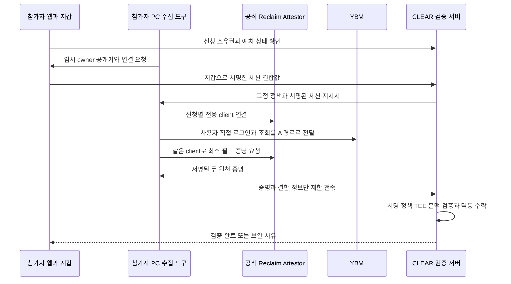

# W02 기존 YBM 성공 경로의 v4 적용 설계 검토

2026년 10월 10일 · 설계 검토 완료 · 구현 및 실제 로그인 전

**공식 Reclaim Attestor의 동일 client로 로그인과 증명을 수행한 경로를 v4 수집 후보로 채택한다. 수동 provider 작성기의 복구는 선행 조건에서 제외한다.** 다만 과거 실행기를 그대로 제품에 연결하지 않는다. 참가자 PC의 수집 도구, 서버의 증명 검증, 신청·지갑 결합을 분리하고 기존 TEE 요구를 충족하는지 먼저 확인한다. 현재 판정은 **합성 이식 시험 진행 가능, 실제 수집·지급 연결은 미준비**다.

이 문서는 동결된 [기술 설계](../reference/DESIGN.ko.md)의 수집 경로 검토를 구체화하는 추가 설계다. 원본 PRD·설계·실험 코드를 덮어쓰지 않는다. 800점·80%, 예치 후 지갑 고정, 동일 시험 중복 지급 차단, 발급 후 직접 청구, 원본 삭제, 실제 YBM 지급 1건과 각자 PC 체험 목표는 유지한다.

## 확인한 근거와 재사용 범위

과거 성공은 실제 계정 1개의 성적 증명과 응시자·성적 연결이다. 일반 로그인과 증명 경로가 다르면 302, 같은 공식 Attestor client를 사용하면 200 및 증명 생성·검증 성공으로 기록됐다. 네트워크 경로 의존성은 확인됐지만 YBM 내부의 정확한 세션 판정 방식은 미확인이다. 현재 다시 연결한 결과는 아니다. [성적 성공 요약](/Users/ohgyuwon/.codex/.chatgpt-projects/g-p-6a9fbda3d8e88191aa2320656de7fb49/experiments/clear-sticky-attestor-2026-10-09/success-summary-2026-10-09.json)

| 기존 자산 | 재사용할 설계 | v4에서 바꿀 부분 |
| --- | --- | --- |
| `identity-route.mjs` | HTTPS CONNECT와 증명에 동일한 공식 Attestor client 사용 | 신청별 독립 프로세스·연결, 임시 프로필, 종료·정리, 인증된 로컬 연결. 전역 client pool 공유 금지 |
| `prove-linked.mjs` | 두 HTTP 원천, 비밀 요청 필드, 공통 owner/context, UTF-8 추출 주의점 | 임시 owner를 참가자 지갑에 사전 결합, 최소 추출, 정책 고정, runtime별 결과 변환 |
| `verify-linked.mjs` | 공증자 서명·정책 hash·URL/method·문맥·시험키 대조 | 사용자별 `policy.expected` 제거, 서버 정책으로 검증, 영속 nonce·멱등 처리 |
| W02 합성 adapter | typed-data binding, 신선도, 역할·시험키 대조, 변조 거부 | hosted 전용 필드 분리, 실제 수신·TEE·DB 트랜잭션 추가. `REAL_MODE_DISABLED` 유지 |

기존 `createClaimOnAttestor` 타입은 `ownerPrivateKey`, `context`, 이미 열린 `client`를 받을 수 있다. 공식 claim 생성 안내도 provider params와 signed context를 받는 직접 경로를 설명한다. 이는 콘솔 provider 등록을 거치지 않는 설계의 근거이며, 현재 YBM 호환성이나 TEE 완료의 근거는 아니다. [공식 claim 생성 안내](https://github.com/reclaimprotocol/attestor-core/blob/main/docs/claim-creation.md)

## 구성과 개인정보 경계

수집 도구는 참가자 PC에서 실행되는 제품 구성요소 후보다. 일반 CLEAR 서버에서 로그인 브라우저를 대신 운영하는 안은 채택하지 않는다. 그러면 서버가 YBM 인증 정보를 처리하는 구조로 바뀌기 때문이다. 기존 CLI·Chrome 디버깅 코드를 그대로 참가자에게 실행시키는 것도 최종 사용자 흐름으로 인정하지 않는다.

| 정보 | 허용 위치와 전송 | 수명 |
| --- | --- | --- |
| YBM 비밀번호 | 사용자가 YBM 인증 화면에 입력. 수집 도구는 로그인 요청 본문을 수집하지 않음 | 앱 로그·파일·CLEAR API에 남기지 않음 |
| 쿠키와 비공개 요청 필드 | 참가자 PC의 전용 브라우저·수집 프로세스 메모리에서 SDK `secretParams`로 처리 | 성공·취소·세션 만료·연결 단절 시 종료 및 폐기 |
| 전체 HTML | 필요한 원천 응답만 제한된 로컬 메모리에서 파싱 | 최소 증명 추출·검증 준비 후 즉시 폐기 |
| owner 개인키 | 참가자 PC에서 생성하는 세션 전용 키. 지갑 개인키와 별개 | 세션 종료 시 폐기. 파일·서버·채팅으로 전송하지 않음 |
| 원본 proof | 로컬에서 선별한 최소 증명만 검증 서버로 전송. 서버의 검증된 tmpfs staging 사용 | 패킷 발급 후 즉시 삭제, 실패·중단 포함 최초 수집 후 최대 24시간 |
| 최소 검증 이력·청구 자료 사본 | 제한 DB·필요한 참가자 및 운영 담당자 | 최종 청구 마감 후 30일 이내 삭제 |

기존 gateway의 ‘TLS interception 없음’은 gateway에 대한 설명이다. 기존 capture 모듈은 요청 헤더와 응답 본문을 읽으므로 새 수집 도구도 인증 정보를 일시 취급한다. CLEAR 서버가 비밀번호·쿠키를 받지 않는다는 경계와 구분해 안내한다. SDK가 만든 전체 `ClaimTunnelResponse`에는 request/transcript가 포함될 수 있으므로 통째로 서버에 보내지 않는다. 허용된 claim 필드·서명·필요한 attestation만 추출하고 cookie/header·원문·개인키 필드가 섞이면 전송 전에 실패시킨다. 이 검사는 요청 정책 검증을 대신하지 않는다.

수집은 로그인 완료 후 허용한 YBM 두 endpoint·method에만 켠다. 기존 범용 `startCapture`를 그대로 사용하면 관련 없는 로그인 요청까지 수집할 수 있으므로 최초 네트워크 이벤트 단계에서 필터링해야 한다. 로그인·증명 중 시스템 프록시는 바꾸지 않고 전용 브라우저만 연결한다. TLS 인증서 검증을 끄거나 루트 인증서를 설치하지 않는다.

브라우저 프로필에는 쿠키·캐시가 남을 수 있다. 프로필·캐시·crash dump·임시 파일까지 휘발 저장에 두고 swap·core dump·백업으로 흘러가는지 확인한다. Linux tmpfs도 swap 가능성이 있으므로 이름만 확인해서 통과시키지 않는다. 기존 macOS 디스크 프로필 경로를 재사용하지 않고, 대상 OS별로 검증한 RAM 기반 경계가 없으면 실제 수집을 시작하지 않는다. JavaScript 메모리 삭제만으로 완전한 지움이 보장된다고 주장하지 않는다.

## 지갑과 owner 결합 순서

1. 서버는 지갑 인증·신청 소유권·동의·예치 상태를 확인한 뒤 일회 `proofSessionId`, `requestNonce`, 역할별 `sourceRequestId`를 만든다. 동시에 열린 세션은 신청당 하나로 제한한다.
2. 참가자 PC 도구가 새로운 secp256k1 owner key를 생성한다. 공개키는 검증 가능한 65바이트 비압축 형식으로 고정하고 서버는 곡선상 유효성과 `computeAddress` 결과를 검사한다. 개인키는 참가자 PC에서만 사용한다.
3. 기존 `ProofSessionBindingV4` 구조와 EIP-712 domain으로 참가자 지갑이 서명한다. `ownerPublicKey`, applicationId, 고정 learner, policyHash, runtimeConfigHash, sessionId, nonce, expiresAt가 모두 포함된다. domain·runtime에는 chain·vault·환경 instance가 결합돼야 한다. 프로덕션 sessionId와 SDK/Reclaim 앱 ID를 같은 식별자로 혼동하지 않는다.
4. 서버가 서명을 검증하고 불변 binding을 저장한 뒤 수집을 허용한다. 도구는 서버 지시서의 서명·대상 origin·만료·policy/runtime hash를 확인한다. 기존 owner를 나중에 바꾸거나 증명 생성 후 소급 서명하는 경로를 두지 않는다.
5. 두 proof의 `claimData.owner`가 등록된 공개키에서 계산한 주소와 같아야 한다. owner 키를 갖고 있다는 사실을 YBM 실명 확인으로 해석하지 않는다. 참가자 지갑의 개인키를 Reclaim SDK에 전달하지 않는다.

로컬 도구와 웹을 연결할 때는 서명된 일회 연결 지시서, 허용 origin·Host, nonce, 제한 포트·메시지 크기·명령 목록을 검사한다. loopback이라는 이유만으로 신뢰하지 않는다. 임의 URL 전달, 외부 사이트의 수집 시작·결과 조회, 다른 신청의 지시서 재사용을 막는다. 연결 비밀은 URL query·로그에 넣지 않는다. 구체적인 확장/native messaging 또는 로컬 연결 구현은 다음 합성 spike에서 선정한다.

## provider와 context 대응

직접 경로에서 `claimData.provider`는 `http`다. 여기에 콘솔 provider UUID를 만들거나 복사해서 넣지 않는다. 콘솔 provider 버전 대신 CLEAR가 검토한 **source policy bundle**을 사용한다. bundle은 두 원천의 정확한 URL·method, 요청 body 템플릿, 허용 header 규칙, 추출·가림 규칙, 문자 인코딩, 날짜·점수 parser 버전과 role을 고정하고 canonical hash로 식별한다. SDK의 요청 hash가 모든 header를 포함하지 않는 부분은 별도 검사한다.

`runtimeConfigHash`는 route discriminator, source policy bundle hash, server verifier build·lockfile hash, attestor 신뢰 집합, 필요한 TEE 모드·설정, 환경·contract 지문을 결합한다. 클라이언트가 보낸 runtime 버전 문자열을 실행 무결성 증거로 신뢰하지 않는다. 정책·서버 runtime은 세션 중 변경하지 않는다. 변경이 필요하면 진행 세션을 끝내고 새 동의·세션 요건을 확인한다.

| 개념 | hosted SDK 후보 | 직접 Attestor 후보 |
| --- | --- | --- |
| 경로 | `HOSTED_SDK` | `DIRECT_ATTESTOR` |
| 원천 식별 | 실제 provider ID·정확한 버전 | 내부 source policy ID·revision·bundle hash. vendor 등록 ID로 표현하지 않음 |
| Reclaim 세션 | SDK가 발급한 실제 ID | 없음. 임의 ID를 Reclaim 발급값처럼 만들지 않음 |
| 역할별 요청 ID | vendor session과 내부 요청 ID 대응 | 서버가 발급한 `sourceRequestId` |
| 공통 검증 | wallet binding, owner, source, 신선도, 서명·추출·시험키 검사 | 동일 |

직접 경로의 signed context는 `clearSchemaVersion`, `clearRoute`, `clearBindingHash`, `clearSourceRole`, `clearSourceRequestId`, `clearSourcePolicyHash`를 포함하도록 제안한다. 세션·신청·지갑·환경·만료는 binding hash로 결합한다. role/requestId는 서버의 불변 record와 대조한다. `extractedParameters`는 원천 검증이 만든 서명된 필드만 신뢰한다. 클라이언트 입력으로 같은 이름을 넣어 덮어쓸 수 없는지 합성 공격 시험으로 확인한다. 검증 코드가 proof의 context를 재작성해서 서명을 맞추려 해서는 안 된다.

현재 합성 adapter의 `reclaimSessionId` 필수 검사는 hosted 분기로 유지하고 직접 경로는 별도 discriminator와 필수 필드 검사로 추가한다. 필드를 optional로 바꾸거나 누락 시 두 경로를 자동 추측하지 않는다. 직접 증명에 임의 `reclaimSessionId`를 넣어 기존 검사를 통과시키지 않는다.

## TEE 검토 결과와 실제 수집 조건

**공식 공증자의 서명 성공과 TEE 검증 성공은 다르다.** 고정 SDK 5.8.2에는 아래 두 검증 경로가 독립적으로 존재한다.

| 검증 | 필요한 자료 | 확인한 제약 |
| --- | --- | --- |
| `teeAttestation` | proof의 TEE bundle, 요청 nonce·앱·세션 문맥, 앱 secret | 서버에서 `verifyTeeAttestation` 수행. 누락은 실패. 단순 `assertVerifiedProof`로 대체 불가 |
| `attestorTeeAttestation` | witness의 `claimAttestation`, claim signature와 공증자 주소에 묶인 attestation report | 서버의 인증서·서명·유효성 검사 및 검토된 image digest 고정. 첫 응답의 digest를 자동 신뢰하지 않음 |

SDK 사용 안내도 요청 시 설정과 서버 검증을 구분한다. in-app 옵션 문서는 TEE+MPC와 일반 proxy attestor 흐름을 구분하므로, 일반 경로 성공을 TEE+MPC 성공으로 부를 수 없다. [SDK 안내](https://docs.reclaimprotocol.org/manual/js-sdk/usage), [검증 옵션](https://docs.reclaimprotocol.org/manual/inapp-sdks/advanced/verification-options)

과거 generator가 구성한 proof에는 `claimData`, identifier, 추출 필드, signatures, witness id/url만 있다. TEE 자료를 보존·검증하는 코드가 없다. 설치된 attestor-core 5.1.4 타입의 해당 `InitResponse`와 `ClaimTunnelResponse`에도 두 SDK 검증기가 바로 요구하는 필드가 드러나지 않는다. 같은 패키지에 `ClaimTeeBundleRequest`가 있다는 사실만으로 기존 `createClaimOnAttestor` 경로의 호환성을 인정할 수 없다.

따라서 다음 공개·합성 기술 시험에서, 기존 동일 client 경로가 필요한 attestation을 생성·전달할 수 있는지 확인한다. 반환 원문에서 누락된 자료를 변환 과정에서 복원했다고 꾸미거나 boolean 성공값으로 대신하지 않는다. 다른 생성 경로·업그레이드가 필요하면 같은 연결 유지와 전체 proof 형식을 다시 검토한다.

이번 설계는 현재의 `teeAttestation` 필수 요구를 제거하지 않는다. 공증자 TEE만으로 대체하는 것도 보장 변경이므로 자동 채택하지 않는다. 직접 경로에서 요구를 충족할 수 없다는 구체적인 결과가 나오면 지원되는 수집 경로 또는 보장 변경안을 비교해 사용자에게 결정 항목을 제시한다. 기본 claim 생성에 앱 secret이 없었다는 사실과 TEE를 포함한 v4 최종 경로의 앱 필요 여부는 구분한다.

## 증명 수신과 검증

직접 경로는 Reclaim 기본 relay callback을 사용하지 않고 도구가 CLEAR의 명시적 HTTPS endpoint에 proof envelope를 전송하는 후보로 둔다. 로컬 실험은 같은 검증 인터페이스를 격리 IPC로 호출할 수 있다. 전송 방식은 권한 증거가 아니며 URL의 sessionId만으로 수락하지 않는다. 서버 인증·지갑 binding·증명 검증은 모두 필요하다.

검증 순서는 크기·schema·경로 discriminator → 서버 session·동의·예치 상태 → 지갑 typed signature → 고정 공증자 집합의 서명·identifier → source policy·URL/method/header → owner·signed context·role/requestId → 신선도·TEE → 추출 schema·두 시험 연결이다. JSON 파싱 실패, 중복 키, 예기치 않은 추가 필드, 역할 누락은 거부한다. 현재 128 KiB 제한은 합성 proof 기준이므로 TEE 포함 공개 샘플 크기를 측정해 유한 상한을 고정하고 바이트 초과를 streaming 단계에서 끊는다. 상한을 무제한으로 풀지 않는다.

세션 기본 30분, proof 최대 나이 30분, 미래 오차 60초는 유지한다. 서버 시간으로 검사하고 proof가 세션 시작 전이면 거부한다. SDK TEE nonce의 별도 시간 제한도 동시에 만족해야 한다. 최고점·기간·800점·수강률은 W05가 평가하며 ProofAdapter가 지급을 승인하지 않는다.

| 상태 | 동작 |
| --- | --- |
| `BOUND` | owner와 지갑 binding 고정, 수집 시작 가능 |
| `COLLECTING` | 한 신청의 전용 client 사용. 다른 신청의 쿠키·연결·메모리와 격리 |
| `PARTIAL` | 한 역할만 확보. 기한 내 같은 살아 있는 연결에서 나머지 생성 가능, 지급 판정 없음 |
| `VERIFYING` | 제한 staging에서 두 역할 검증. 중복 요청은 같은 처리 상태 반환 |
| `PROOF_VERIFIED` | DB transaction으로 session 소비와 검증 결과를 함께 기록. 지급·packet 완료 상태 아님 |
| `RETRY_REQUIRED` | 인증/연결 종료 등으로 새 로그인 필요. 새 owner·nonce·세션으로 재시작, 이전 세션 무효화 |
| `EXPIRED` / `CANCELLED` / `REJECTED` | 종료·정리. 오류 종류에 따라 재시도 안내, 원천 장애를 조건 미충족으로 변환하지 않음 |

동일 client가 끊기면 URL이 같다는 이유로 자동 새 연결 후 기존 쿠키를 재사용하지 않는다. SDK 내부 자동 재시도로 다른 client가 선택되지 않는지도 검사한다. 동일 endpoint의 전역 pool은 여러 참가자를 격리하지 못하므로 신청별 프로세스 또는 명시적으로 독립된 client를 사용한다.

`proofSessionId`에 unique 제약과 row lock을 두고 검증 후 최종 커밋 시에도 만료·소유권·세션 상태를 재확인한다. 같은 canonical envelope hash는 같은 결과를 반환하고, 소비된 세션의 다른 내용은 충돌로 거부한다. 실패한 proof가 일회 nonce를 성공 소비한 것으로 기록되지는 않지만, 무한 재시도 대신 유한 시도 제한을 둔다. 클라이언트 재시작은 새 세션이며, 서버 처리 중단 뒤 이미 접수된 envelope의 재검증은 원래 만료·보관 상한 안에서만 허용한다.

같은 시험의 다른 발급·신청 차단은 기존 course 단위 examNullifier와 W09의 원자적 예약·지급 권한 등록으로 처리한다. Reclaim identifier나 session nonce만으로 시험 중복 지급을 막았다고 보지 않는다.

## 최소 필드와 복수 응시

접수 proof는 시험 종류·시험일·수험번호, 성적 proof는 같은 키와 총점만 필수로 한다. 이름·생년월일은 새 정책에서 추출하지 않는다. 필요 없는 필드를 이미 서명된 proof에서 삭제하는 대신 처음부터 가리고 새 증명을 만든다. 기존 POST의 `encExamData`는 비밀 요청 매개변수, 빈 `zzxxcc`는 문자 그대로 빈 값으로 처리한 성공 기록을 참고하되 현재 source policy로 다시 검증한다. 인코딩·정규식 byte 위치·HTML 구조 변경 시 추측해서 값을 보완하지 않는다.

과거 단일 시험 regex를 첫 매치만 선택하는 정책으로 그대로 이식하지 않는다. 실제 페이지의 시험 행을 분리하고 각 행에서 시험키·총점이 함께 추출되도록 하며, 중복/모호한 매치는 보류한다. 검증된 시험 쌍의 집합에서 최고 총점을 선택하고, 각 pair는 서로 다른 role request ID로 같은 신청 binding에 묶는다. 페이지가 일부만 조회됐으면 확인 범위를 표시하고 확인된 낮은 점수를 영구 탈락으로 확정하지 않는다. 서로 다른 시험의 LC·RC 조합은 금지한다. W02 최초 실측은 1쌍, 복수 응시 선택과 누락 처리 시험은 W05/W08 통합 완료 기준으로 유지한다.

## 11월 7일 제품 목표와 단계별 적용

전용 PC 도구는 사이트 접속만으로 실행되지 않는다. 따라서 **로컬 실제 YBM 증명 1건의 경로 확인**과 **각자 PC에서 개발자 도움 없이 쓰는 제품**을 별도 검증한다. 기존 PRD는 체험자가 합성 시험 자료를 사용할 수 있도록 허용한다. 두 체험자의 웹 과업과 실제 YBM 지급 1건은 별도 표본으로 유지하되, 이것을 모든 참가자 PC에서 YBM 실연동까지 완료한 결과로 표현하지 않는다. 사용자 기기에 helper를 설치하는 경험을 최종 기본 흐름으로 채택할지는 패키징·OS·권한·초기 설치 과업을 검토한 뒤 확정한다.

| 구현 순서 | 추천 모델과 추론 | 산출물과 완료 기준 | 사용자 조작 |
| --- | --- | --- | --- |
| W02 A 공개 인터페이스 및 합성 호환성 | GPT-6 Astra / high | TEE 종류와 실제 지원 경로, 직접 source/context mapping, owner binding 벡터. 누락·변조·route 교환 거부 | 없음 |
| W02 B 수집 경계와 연결 격리 | GPT-6 Astra / high | 합성 웹 원천으로 전용 client·중단·재시도, 저장·로그·프로필·로컬 연결 제한 검증 | 없음 |
| W02 C 실제 경로 최소 확인 | GPT-6 Astra / high | 최소 필드 새 1쌍, binding·필수 TEE·삭제. W02 용도는 지급 불가로 표시 | 이 단계 직전에 YBM 로그인 안내 |
| W03 및 W04 | GPT-6.1 Sol / high, GPT-6 Astra / high | 외부 지갑·환경 결합, 정책/runtime canonical hash 확정 | 지갑 연결 시험 시 안내 |
| W08 및 W11 | GPT-6 Astra / high | 실제 adapter·DB atomic commit·수집/원본 TTL. W11의 원본 저장 경계를 수집 전 선행 | 필요한 경우 새 로그인 |
| W12 | GPT-6 Astra / high | 새 증명으로 800점·시드80% 확인 및 로컬 실제 지급 1건 | 지급 세션에 맞춰 새 로그인; W02 proof 재생 금지 |
| W13부터 W15 | GPT-6.1 Sol / high, 체험 관찰은 medium | 다른 PC 웹 과업·개발자 도움 없는 복구·합성 체험 2명. 실제 수집 도구 배포 범위는 별도 명시 | 체험 일정과 역할 조율 |

10월 13일 P1에서는 TEE 호환성과 수집 경계가 해결되지 않으면 실제 경로를 미완료로 유지하고 대안과 일정 영향을 보고한다. 10월 21일 실제 로컬 지급, 10월 27일 외부 PC 접속, 11월 2일 체험 검증, 11월 7일 시연 목표는 기존 계획을 유지한다. 모델 권고는 OpenAI Docs의 모델 선택 안내와 프로젝트 위험도에 따른 판단이며 자동 전환이나 실측 우위 주장이 아니다. [공식 모델 선택 안내](https://developers.openai.com/api/docs/guides/model-selection)

## 다음 시험의 수락 기준

아래는 작성된 시험 계획이며 실행 결과가 아니다. 기존 36개 합성 시험을 실제 경로 검증으로 합산하지 않는다.

| 검증 묶음 | 필수 통과 사례 |
| --- | --- |
| 지갑 binding | 다른 owner·application·지갑·chain·vault·instance·정책·만료·서명 거부; 수취 지갑 키 미전달 |
| 원천과 문맥 | hosted/direct 바꿔치기, 임의 Reclaim 세션 ID, role 교환, 사용자 주입 extractedParameters, URL·method·정책/가림 변조 거부 |
| TEE | 필요한 실제 형식으로 검증 성공, 자료 누락·다른 claim·다른 signer·nonce·만료·허용되지 않은 image 거부. 합성 TEE 성공으로 실측 대체 불가 |
| 생성 연결 | 두 합성 신청이 client·owner·쿠키·프로필을 공유하지 않음; 끊긴 연결 자동 교체 금지; 한 proof만 생성 후 중단 시 지급 판정 없음 |
| 수신과 멱등 | 크기 초과·오류 JSON·중복 키 거부, 동시 동일 제출 한 번 수락, 다른 내용 충돌, commit 직전 만료·취소 거부 |
| 개인정보 | 쿠키·key·원문이 API·오류·로그·백업에 없음; 최소 proof만 수신; 성공·취소·crash·24시간 경계 정리 |
| 시험 기록 | 동일 행 필드 결합, 모호한 매치 보류, 기간 내 최고점, 불완전 목록·복수 시험·동일 시험 재발급 처리 |
| 제품 사용 | 참가자가 개발자 터미널·수동 쿠키 복사 없이 시작/취소/재시도, 원본 삭제 뒤 기존 독립 청구 유지 |

## 결론과 남은 결정

추가 사용자 결정 없이 진행할 수 있는 다음 작업은 **W02 A의 공개·합성 호환성 spike**다. 실제 YBM 로그인은 TEE 경로, owner 사전 결합, 수집 도구 개인정보 경계, 제한 staging과 종료 처리를 확인한 뒤 요청한다. 현재 로그인 요청은 필요 없다.

현재 미확정 사항은 직접 생성 경로의 필수 TEE 지원, 참가자 도구 배포·OS 지원, runtime 최종 버전과 원천 최소 추출 정책이다. 기술 확인 전에 TEE를 약화하거나 원본을 일반 디스크에 저장하는 선택을 하지 않는다. 기술 확인 결과에 따라 제품 경험이나 보장 변경이 필요할 때만 구체적인 대안을 제시하고 한 항목씩 질문한다.

근거 파일 및 해시는 [설계 검토 기록](v4-route-review.json)에 있다. 기존 증명·쿠키·개인키를 읽거나 제품 코드를 수정하지 않았다. 과거 실행기도 재실행하지 않았다.
